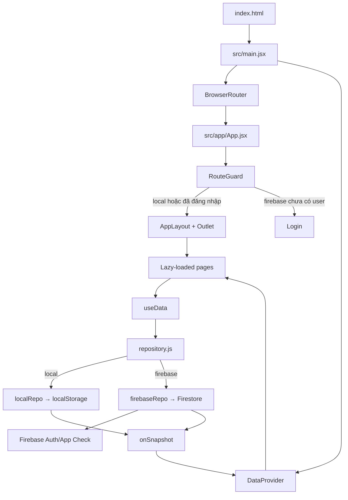

# PROJECT OVERVIEW — Nhịp việc

> Tài liệu onboarding này được lập từ mã nguồn hiện có ngày 03/11/2026. Nhận định có đường dẫn là điều đã kiểm tra trong code; nội dung đánh dấu **(suy luận)** là kết luận kiến trúc/sản phẩm từ nhiều dấu hiệu. Các báo cáo lịch sử được đối chiếu nhưng không được ưu tiên hơn code hiện tại. Không có giá trị secret hay giá trị biến môi trường nào được ghi trong tài liệu.

## 1. Tổng quan

**Nhịp việc** là ứng dụng web tiếng Việt để một cá nhân hoặc nhóm nhỏ quản lý dự án, nhiệm vụ, lịch, chuyến công tác, danh bạ và sổ tay trong cùng một giao diện. Luồng chính là tạo dự án/nhiệm vụ, theo dõi trạng thái và tiến độ, xem hạn trên lịch, liên kết việc với chuyến đi/người liên quan, rồi ghi chú bối cảnh. Mô tả này được xác nhận từ router và các page trong `src/app/App.jsx`, `src/pages/` và README `README.md`.

- Loại dự án: Single Page Application (SPA), frontend-only, responsive/PWA shell; không có API server riêng (`index.html`, `src/main.jsx`, `public/manifest.webmanifest`).
- Đối tượng: người dùng Việt Nam quản lý công việc cá nhân hoặc nhóm nhỏ **(suy luận từ ngôn ngữ, mô hình dữ liệu theo user và README; code chưa có workspace/team sharing)**.
- Hai chế độ dữ liệu: localStorage không cần tài khoản, hoặc Firebase Auth + Cloud Firestore theo tài khoản (`src/data/repository.js`).
- Trạng thái hiện tại: **đang phát triển, chức năng chính gần hoàn thiện nhưng còn lệch giữa code, test và tài liệu**. CRUD và UI nghiệp vụ đã rộng; một số test là file rỗng, smoke test còn kỳ vọng seed đã bỏ, một số liên kết xóa chưa được dọn đầy đủ.
- Production được README công bố tại `https://quan-ly-cong-viec-sable.vercel.app`; tài liệu này không xác minh trạng thái deployment trực tiếp (`README.md`, `vercel.json`).

## 2. Tech stack

### Runtime và thư viện

| Thành phần | Phiên bản khóa | Vai trò | Nguồn |
| --- | ---: | --- | --- |
| JavaScript/JSX, ES modules | ES2022 lint target | Ngôn ngữ toàn ứng dụng | `package.json`, `eslint.config.js` |
| React | 18.3.1 | UI/component/state | `package.json`, `pnpm-lock.yaml` |
| React DOM | 18.3.1 | Mount ứng dụng | `src/main.jsx` |
| React Router DOM | 7.18.4 | SPA routing, query params | `src/app/App.jsx`, lockfile |
| Vite | 8.3.5 | Dev server, build, code splitting | `vite.config.js`, lockfile |
| Firebase | 13.1.0 | Auth, Firestore, App Check | `src/data/firebase.js`, lockfile |
| date-fns | 4.4.0 | Tính/định dạng ngày | `src/lib/dates.js`, các page |
| Lucide React | 1.61.0 | Icon | các component/page |
| Manrope | 5.3.0 | Font Việt 500/700 | `src/main.jsx` |

`package.json` dùng nhiều specifier `latest`; phiên bản thực tế ở trên lấy từ `pnpm-lock.yaml`. Điều này làm lần cập nhật lockfile sau có thể thay đổi lớn ngoài ý muốn.

### Dữ liệu và dịch vụ ngoài

- Database: Cloud Firestore tùy chọn; đường dẫn `users/{uid}/{projects,tasks,contacts,trips,notebooks,notes}` và `users/{uid}/meta/tagColors` (`src/data/firebaseRepo.js`, `firestore.rules`).
- Lưu cục bộ: nhiều khóa localStorage; không dùng IndexedDB trực tiếp. Firestore bật persistent local cache nhiều tab (`src/data/localRepo.js`, `src/data/firebase.js`).
- Auth: Firebase Email/Password và Google; persistence kiểu local; email verification và reset password (`src/data/firebase.js`).
- App security: Firebase App Check với reCAPTCHA v3 nếu có site key (`src/data/firebase.js`).
- Cache/queue/object storage: không có / không rõ. `storageBucket` chỉ được chuyển vào Firebase config, code không gọi Firebase Storage.
- Thanh toán, email nghiệp vụ, API ngoài khác: không có. Email chỉ là Firebase Auth và liên kết `mailto:`.

### Tooling

- Package manager: pnpm; Node 24 theo `AGENTS.md`.
- Lint: ESLint 10, React Hooks, React Refresh; không có formatter config (`eslint.config.js`).
- Unit/component: Vitest 5, jsdom, Testing Library (`vite.config.js`, `tests/`).
- E2E/accessibility: Playwright 1.64, axe-core; ba viewport 360/768/1280 (`playwright.config.js`, `e2e/`).
- Audit: script contrast, motion và UI baseline; các JSON Lighthouse/screenshot là artifact lịch sử (`scripts/`, `docs/audit/`, `docs/screenshots/`).
- CI: **Không có / không rõ**; không tìm thấy `.github/workflows`, GitLab CI hay cấu hình CI khác.
- Deploy: Vercel SPA rewrite (`vercel.json`); `firebase.json` cũng định nghĩa Firestore rules và Firebase Hosting rewrite nhưng quy ước hiện tại dùng Vercel.
- Container: không có Dockerfile/Compose.

## 3. Cấu trúc thư mục

```text
.
├── index.html                 # HTML shell, mount #root, manifest/theme metadata
├── public/
│   └── manifest.webmanifest  # PWA manifest; không có service worker
├── src/
│   ├── main.jsx              # Entry point; provider/router/CSS/font
│   ├── app/App.jsx           # Router, lazy pages, route guard
│   ├── auth/                 # Validate form và map lỗi Firebase Auth
│   ├── components/
│   │   ├── create/           # Modal tạo dự án + nhiều nhiệm vụ
│   │   ├── layout/           # Topbar, dock, banner, profile, global search
│   │   ├── mindmap/          # Dựng cây, mind map, treemap, squarify
│   │   ├── notes/            # Card/form/row/template sổ tay và ghi chú
│   │   ├── project/          # ProjectForm
│   │   ├── tags/             # Nhập, lọc, hiển thị, quản lý nhãn
│   │   ├── task/             # TaskForm và TaskCard
│   │   └── ui/               # Button/modal/drawer/popover/toast/progress
│   ├── data/                 # Repository selector, local/Firebase adapter, seed
│   ├── hooks/                # Data/Auth/Toast context, theme và motion hooks
│   ├── i18n/vi.js            # Một phần chuỗi tiếng Việt tập trung
│   ├── lib/                  # Logic thuần về task/project/trip/note/date
│   ├── pages/                # Bảy phân hệ và Login
│   ├── styles/               # CSS thuần theo feature + design tokens
│   └── tags/                 # Chuẩn hóa/catalog/mutation nhãn
├── tests/
│   ├── unit/                 # Test helper/repository/recovery
│   └── component/            # Test form, modal, empty state, tag
├── e2e/                      # Smoke, project CRUD, drawer, long text, axe
├── scripts/                  # Contrast, motion, ảnh/audit UI
├── docs/
│   ├── audit/                # Lighthouse và đo UI sinh tự động
│   ├── baseline/             # Baseline; file hiện đọc được là rỗng
│   └── screenshots/          # Nhiều PNG before/after/fix; artifact lớn
├── README.md                 # Tài liệu sản phẩm/chạy/deploy
├── README_AI.md              # Bản đồ code cũ nhưng khá sát hiện trạng
├── DESIGN.md                 # Design system/wireframe và lịch sử triển khai
├── AUDIT.md                  # Audit trước đợt UI refresh
├── CHANGELOG.md              # Lịch sử thay đổi và kết quả cũ
├── AGENTS.md                 # Quy tắc làm việc trong repo
├── firestore.rules           # Rules theo user và validation một phần
├── firebase.json             # Firestore rules + Firebase Hosting SPA
├── vercel.json               # Vercel SPA rewrite
├── vite.config.js            # Alias, chunking, Vitest
├── playwright.config.js      # E2E projects và local-mode server
├── eslint.config.js          # Lint rules
├── .env.example              # Tên biến mẫu; không ghi giá trị ở đây
├── .env.local                # Có trên máy, bị ignore; không công bố giá trị
├── pnpm-lock.yaml            # Lockfile lớn, chỉ dùng để xác nhận phiên bản
├── pnpm-workspace.yaml       # Một workspace package duy nhất
└── .agents/skills/           # Tooling hướng dẫn Gemini, không thuộc runtime app
```

`node_modules/`, `dist/`, `.git/`, `.vercel/`, ảnh PNG và JSON audit lớn được ghi nhận nhưng không phân tích từng byte vì là dependency/build/generated/binary artifact.

## 4. Kiến trúc

### Kiểu kiến trúc

Ứng dụng dùng kiến trúc frontend phân lớp nhẹ:

1. **Presentation**: page/component React trong `src/pages/` và `src/components/`.
2. **Application state/facade**: `DataProvider` và `useData()` trong `src/hooks/useData.jsx` cung cấp state, mutation, auth, lỗi và toast.
3. **Repository abstraction**: `src/data/repository.js` chọn một trong hai adapter có giao diện gần giống nhau.
4. **Persistence/integration**: `localRepo.js` hoặc `firebaseRepo.js` + `firebase.js`.
5. **Domain helpers**: các hàm thuần trong `src/lib/` và `src/tags/`.

Đây không phải MVC/clean architecture đầy đủ: page vẫn chứa nhiều orchestration nghiệp vụ, validation và cascade xóa; model là object JavaScript không có type/schema tập trung.

### Luồng khởi động và dữ liệu



### Mutation chuẩn

1. Form/page validate input phía client.
2. Caller gọi `create`, `update`, `remove` hoặc `batch` từ `useData()`.
3. Wrapper `run()` bắt lỗi, trả `null` khi thất bại, cập nhật global error và toast.
4. Adapter ghi localStorage hoặc Firestore.
5. Subscription phát state mới về `DataProvider`; UI render lại.
6. Caller đóng form/hiện toast; một số hành động lưu snapshot để undo trong 6 giây.

Không có REST/GraphQL request nội bộ. Các component không nên gọi Firestore trực tiếp; ngoại lệ có chủ ý là hook/theme đọc preference localStorage.

### Phụ thuộc giữa phân hệ

- Task là thực thể trung tâm, tham chiếu project, trip và contact; Dashboard, Calendar, Trips, Contacts, MindMap đều đọc task.
- Project/trip/contact xóa sẽ cố gỡ một số tham chiếu task trước khi xóa.
- Note có liên kết mềm tới project/trip/contact nhưng không có foreign key hoặc cascade tổng quát.
- Tag được lưu trực tiếp trên task/note; màu nằm ở registry tách rời.
- Toàn bộ state ứng dụng nằm trong một context, nên bất kỳ cập nhật data/toast nào có thể làm nhiều consumer render lại **(suy luận từ `useData.jsx`)**.

## 5. Danh sách tính năng

### 5.1 Dashboard/Tổng quan — **Hoàn chỉnh, có điểm lệch số liệu**

- File: `src/pages/Dashboard.jsx`, `src/lib/tasks.js`, `src/lib/progress.js`, `src/lib/trips.js`.
- Luồng: chọn kỳ hôm nay/tuần/tháng → lưu `nhip-viec-period` → lọc task theo `dueDate` → tính KPI, trạng thái, tiến độ dự án, chuyến sắp tới → KPI điều hướng sang `/cong-viec` với query filter.
- Có: hoàn thành/mở lại trực tiếp, biểu đồ SVG/CSS, cảnh báo trip trùng, empty state, recovery toast.
- Edge case: task `done` không quá hạn; sắp hạn là ba ngày; dự án `done` đứng cuối; trip hoàn thành bị loại khỏi danh sách sắp tới.
- Rủi ro: biểu đồ “hoàn thành 7 ngày” nhóm theo `dueDate`, không theo `completedAt`; kỳ chỉ scope một số KPI trong khi dueSoon/overdue là toàn bộ data.

### 5.2 Nhiệm vụ — **Hoàn chỉnh**

- File: `src/pages/Tasks.jsx`, `src/components/task/TaskForm.jsx`, `TaskCard.jsx`, `src/lib/tasks.js`, `src/lib/progress.js`.
- Luồng tạo/sửa: mở Drawer → state form → validate title/date → batch create/update → repository lưu → subscription cập nhật → toast.
- Hiển thị: Kanban 5 trạng thái, bảng danh sách, view dự án; tìm không dấu; lọc multi-status/multi-priority/tag ANY/project/due; sort theo order/hạn/ưu tiên.
- Dữ liệu: mô tả, dự án, trạng thái, ưu tiên, start/due date, người giao/phụ trách/phối hợp, ghi chú, checklist, progress auto/manual, trip/phase, order, tags.
- Edge case: title input chặn 120; due không trước start; task done có progress 100 và `completedAt`; mở lại tối đa 99; xóa có xác nhận và undo.
- Làm dở: `collaboratorIds` có trong model nhưng form không cho chọn; `tripPhase` không có control; helper order/rebalance tồn tại nhưng UI không có drag-and-drop.

### 5.3 Dự án — **Hoàn chỉnh, validation chưa đồng bộ**

- File: `src/pages/Tasks.jsx`, `src/components/project/ProjectForm.jsx`, `src/lib/projects.js`, `src/lib/projectStatus.js`.
- Luồng: view Dự án → tạo/sửa metadata → validate tên trùng không dấu, ngày → lưu; archive/restore; xóa → batch gỡ/chuyển `task.projectId` → xóa project → có undo.
- Trạng thái lưu: running/paused/done/archived. Trạng thái hiển thị `waiting` được suy ra khi project có ít nhất một task và tất cả task done; không ghi `waiting` xuống DB.
- Edge case: tên UI tối đa 60, không trùng sau chuẩn hóa; project rỗng không tự hoàn thành; task chưa xong được chuyển vào sẽ đưa trạng thái suy ra về nền.
- Rủi ro: `validateProject`, import và Firestore rules cho phép 80 ký tự trong khi UI/AGENTS quy định 60; xóa project không dọn `notes.links.projectId` hay `trips.projectId`.

### 5.4 Tạo nhanh dự án + nhiệm vụ — **Hoàn chỉnh**

- File: `src/components/create/CreateCombo.jsx`, `src/components/layout/AppLayout.jsx`.
- Luồng: dock/menu hoặc `?new=1` → chọn project mới/có sẵn → thêm nhiều task → validate → một batch tạo project và tasks.
- Edge case: task không project được phép; title 120, project 60; project archived không xuất hiện; đang lưu khóa modal.

### 5.5 Nhãn — **Hoàn chỉnh cho task; làm dở cho note**

- File: `src/components/tags/`, `src/tags/tagUtils.js`, `src/tags/tagMutations.js`, hai repository.
- Luồng nhập: normalize NFC/bỏ `#`/gộp space → chống trùng → tối đa 5 nhãn, 24 ký tự → batch lưu item + màu mới → catalog tính count/lastUsed.
- Có: autocomplete, paste nhiều nhãn, IME guard, keyboard, lọc ANY, đổi tên/gộp/xóa/đổi màu, 12 màu ổn định; `/__tags` chỉ DEV.
- Edge case: màu fallback hash ổn định; registry bỏ màu không còn dùng; Firebase dùng `FieldPath` cho key Unicode/dấu chấm an toàn.
- Lỗi: `ManageTagsDialog` luôn lấy `tagCatalog` và `data.tasks`, nên mở quản lý từ Sổ tay vẫn chỉ mutation task; tag riêng của note không được rename/delete đồng bộ.

### 5.6 Lịch — **Hoàn chỉnh**

- File: `src/pages/Calendar.jsx`, `src/lib/dates.js`, `src/lib/trips.js`.
- Luồng: chọn day/week/month và cursor → dựng interval → mỗi ngày lọc task theo dueDate và trip bao phủ ngày → chọn ngày xem agenda; click task sửa; double-click ngày tạo task.
- Đổi hạn task dịch `startDate` theo cùng khoảng cách và có undo.
- Edge case: tháng render cả tuần đầu/cuối; tối đa ba task/ô ở month; trip hiển thị buổi; cảnh báo overlap theo ngày.
- Hạn chế: filtering từng ô là lặp tuyến tính trên toàn bộ task/trip; có thể chậm với dữ liệu rất lớn **(suy luận)**.

### 5.7 Công tác — **Hoàn chỉnh**

- File: `src/pages/Trips.jsx`, `src/lib/trips.js`.
- Luồng CRUD: form ngày + buổi → validate range → normalize defaults → lưu; page nhóm ongoing/upcoming/past; detail nhóm task before/during/after.
- Có: hoàn thành độc lập với ngày; progress chuẩn bị; phát hiện overlap theo half-day slots; task đến hạn trong chuyến; xóa gỡ task link nhưng giữ task.
- Edge case: ngày bằng nhau không cho Chiều→Sáng; trip completed không gây cảnh báo trùng; dữ liệu cũ mặc định Sáng→Chiều.
- Làm dở: `contactIds` và `projectId` được logic đọc nhưng TripForm không có UI chọn contact/project; xóa trip không dọn `notes.links.tripId`.

### 5.8 Danh bạ — **Hoàn chỉnh một phần**

- File: `src/pages/Contacts.jsx`.
- Luồng: tìm tên/đơn vị → CRUD form → detail tập hợp task theo assigner/assignee/collaborator và trip theo contactIds → gọi/soạn email qua `tel:`/`mailto:`.
- Edge case: phone pattern 8–15 ký tự gồm số, `+`, space, chấm, gạch; email dùng native validation; contact `isSelf` không được xóa.
- Cascade xóa: assigner→null, assignee→`self`, xóa khỏi collaboratorIds/contactIds.
- Lỗi/rủi ro: không dọn `project.ownerId` và `notes.links.contactId`; dữ liệu lõi mới không seed contact `self`, dù task mặc định dùng assigneeId `self`.

### 5.9 Sơ đồ — **Hoàn chỉnh**

- File: `src/pages/MindMap.jsx`, `src/components/mindmap/`.
- Luồng: build cây project → group task theo status → nối trip trực tiếp hoặc qua task → render mind map, treemap hoặc list; click task mở Drawer.
- Có: filter project/status, zoom/pan, fit, tối đa 12 leaf/nhóm, nhóm trip chưa gắn dự án; treemap dùng thuật toán squarify tự viết và ResizeObserver.
- Edge case: treemap gom tile quá nhỏ vào “+N nữa”; project weight tối thiểu 1; màn ≤600 mặc định list.

### 5.10 Sổ tay và ghi chú — **Hoàn chỉnh, có lỗi quản lý tag liên phân hệ**

- File: `src/pages/Notebooks.jsx`, `src/components/notes/`, `src/lib/notes.js`, `src/data/noteSeed.js`.
- Luồng sổ: tạo trống/template → batch sổ + note mẫu → grid/list, pin/archive/search/sort → mở `/so-tay/:id`.
- Luồng note: quick add hoặc form → title/body/tags/notebook/pin/links → batch save; search không dấu, filter tag ANY; move/delete/undo.
- Edge case: tên sổ duy nhất không dấu/hoa, tối đa 60; title 120; body 5000; stale link hiển thị “Không còn tồn tại”; xóa sổ xóa note cùng batch rồi cho undo.
- Seed: chỉ khi cả hai khóa sổ/note chưa có, tạo một sổ welcome với hai ghi chú; dữ liệu lõi task/project/contact/trip vẫn rỗng.

### 5.11 Xác thực và nhập local lên cloud — **Hoàn chỉnh, cần hardening**

- File: `src/pages/Login.jsx`, `src/data/firebase.js`, `src/hooks/useData.jsx`, `src/data/firebaseRepo.js`, `src/auth/`.
- Luồng: RouteGuard chặn toàn app trong firebase mode → login/register Google hoặc email → auth observer → ensure profile → migrate → subscribe 6 collections → đề nghị import local.
- Register cập nhật displayName và gửi email verification; reset password luôn trả thông báo trung tính để tránh lộ email tồn tại.
- Google: mobile/coarse pointer dùng redirect; desktop popup, fallback redirect khi popup bị chặn.
- Import: bỏ ID đã tồn tại, validate/normalize loại dữ liệu, batch tối đa 400, copy registry màu đã dùng, backup local core và lưu quyết định theo uid.
- Rủi ro: email chưa verify vẫn được dùng app; verification chỉ là banner. Repository có thể chọn firebase khi chỉ có projectId nhưng SDK chưa configured nếu thiếu API key.

### 5.12 Theme, accessibility và feedback — **Hoàn chỉnh**

- File: `src/components/ui/`, `src/components/layout/AppLayout.jsx`, `src/hooks/useTheme.js`, `useReducedMotion.js`, CSS.
- Có light/dark/system; dock/topbar; global search; route focus H1; modal/drawer focus trap/Escape/restore; dirty guard; popover portal/position; toast close/undo/pause; reduced motion.
- PWA manifest có, nhưng không có service worker nên không phải offline PWA hoàn chỉnh.

## 6. Dữ liệu

### Quy ước chung

- Model là object JavaScript, không có TypeScript/interface/schema tập trung (`README_AI.md`, source).
- Adapter `create` thường thêm `id`, `createdAt`, `updatedAt`; batch create thêm metadata tương tự. Dữ liệu legacy có thể thiếu field.
- Ngày nghiệp vụ: chuỗi `YYYY-MM-DD`; timestamp: ISO string hoặc Firestore server timestamp cho profile.
- Quan hệ đều là ID mềm, không có foreign key/index migration.

### Model

| Collection/model | Trường và kiểu chính | Quan hệ/ràng buộc đã xác minh |
| --- | --- | --- |
| `tasks` | `id:string`, `title:string`, `description:string`, `projectId:string|null`, `status:string`, `priority:string`, `startDate:string`, `dueDate:string`, `assignerId:string|null`, `assigneeId:string`, `collaboratorIds:string[]`, `notes:string`, `checklist:{id,text,done}[]`, `progress:number`, `progressMode:'auto'|'manual'`, `tripId:string|null`, `tripPhase:'before'|'during'|'after'|null`, `order:number`, `tags:string[]`, `completedAt:string|null`, metadata | status 5 giá trị; priority 4; UI title 120; progress 0–100; tags ≤5, mỗi tag ≤24; project/trip/contact là liên kết mềm. |
| `projects` | `id`, `name`, `description`, `colorIndex:number`, `status`, `ownerId`, `startDate`, `dueDate`, `archived:boolean`, metadata | color 1–8; persisted status running/paused/done/archived; UI name 60 nhưng helper/rules 80; tên unique chỉ phía client. |
| `contacts` | `id`, `fullName`, `organization`, `title`, `phone`, `email`, `notes`, `isSelf`, metadata | Được task/project/trip/note tham chiếu; Firestore rules chưa validate field. |
| `trips` | `id`, `name`, `location`, `startDate`, `endDate`, `startSession`, `endSession`, `purpose`, `contactIds:string[]`, `notes`, `color`, `completed:boolean`, `completedAt`, có thể `projectId`, metadata | session sáng/chiều; form name/location 160, purpose 1000, notes 2000; rules chưa validate field. |
| `notebooks` | `id`, `name`, `color:number`, `pinned:boolean`, `archived:boolean`, metadata | name ≤60, color 0–7; note tham chiếu bằng notebookId. |
| `notes` | `id`, `notebookId`, `title`, `body`, `tags`, `pinned`, `links:{projectId?,tripId?,contactId?}`, metadata | title ≤120, body ≤5000, tags ≤5; links mềm; rules yêu cầu links map. |
| user profile | `displayName`, `email`, `photoURL`, `provider`, `createdAt`, `lastLoginAt`, `locale`, `settings:{theme,defaultView,reportPeriod}` | Document `users/{uid}`; createdAt không được đổi bởi rules. |
| tag registry | `{c:{[tagKey]:number}}` | color index 0–11; local key hoặc `meta/tagColors`; rule meta chỉ kiểm tra owner, không validate shape. |

### LocalStorage

| Khóa | Nội dung |
| --- | --- |
| `nhip-viec-v1` | projects, tasks, contacts, trips |
| `nhip-viec-initialized` | đánh dấu core đã khởi tạo |
| `nhip-viec-notebooks` / `nhip-viec-notes` | dữ liệu Sổ tay tách riêng |
| `nhip-viec-tag-colors` | registry màu nhãn |
| `nhip-viec-theme` | light/dark/system |
| `nhip-viec-period` | kỳ Dashboard |
| `nhip-viec-notebooks-view` | grid/list |
| `nhip-viec-v1.pre-migration` | backup trước migration đầu tiên |
| `nhip-viec-v1.corrupt-*` | backup JSON hỏng |
| `nhip-viec-v1.cloud-import-{uid}` | quyết định import/skip |
| `nhip-viec-v1.imported-YYYY-MM-DD` | backup core sau import |

Local recovery giữ nguyên raw hỏng, cố tạo backup và chặn mutation nếu recoveryError. Multi-key write không phải transaction: core và extra có thể ghi thành công/thất bại riêng.

### Firestore và rules

```text
users/{uid}                         # profile
users/{uid}/projects/{id}
users/{uid}/tasks/{id}
users/{uid}/contacts/{id}
users/{uid}/trips/{id}
users/{uid}/notebooks/{id}
users/{uid}/notes/{id}
users/{uid}/meta/tagColors
```

- Mọi read/write yêu cầu `request.auth.uid == uid` (`firestore.rules`).
- Task validate status/priority/progress; project validate name/status/color; notebook/note validate các trường cốt lõi.
- Contacts/trips/meta chỉ kiểm tra collection name + owner; chưa validate schema.
- Không có index config, migration file hay Firebase Emulator config.
- `prepareUserData` chỉ ghi migration cho project/task; trip được normalize khi đọc nhưng không bulk rewrite.

### Seed và migration

- Core seed `emptyData()` là bốn mảng rỗng (`src/data/seed.js`).
- Note seed có một notebook và hai note welcome (`src/data/noteSeed.js`).
- `migrateData` chuyển project string/legacy `projectName`, chuẩn hóa status/color/metadata và map task sang projectId (`src/lib/projects.js`).
- Không có seed script cho Firestore; tài khoản mới không tự nhận task/project mẫu.

### State management

`DataProvider` giữ `data`, loading/error, Firebase user/auth state, import state, tag registry và toast list bằng React Context. Không có Redux/Zustand/query cache. Page giữ UI state cục bộ và nhiều filter task/note được giữ trong URL query.

## 7. API / Giao diện

### API

Không có HTTP endpoint do dự án không có server. “API nội bộ” quan trọng là repository:

| Hàm | Input | Output/hành vi |
| --- | --- | --- |
| `subscribe(name, callback, onError?, uid?)` | collection bị bỏ qua ở cả adapter hiện tại | emit toàn bộ dataset; trả unsubscribe |
| `create(collection, value)` | object | tạo ID/metadata, trả item |
| `update(collection,id,patch)` | patch | merge và cập nhật `updatedAt` |
| `remove(collection,id)` | ID | xóa document/item |
| `batch(ops,registry,currentItems)` | create/update/remove ops | ghi nhiều thay đổi; Firestore atomic, local chỉ tuần tự theo key |
| `subscribeTagColors` | callback | stream registry |
| `saveTaskTags`, `manageTags` | tags/mutations | đồng bộ item và registry |

### Routes và màn hình

| Route | Page | Component/vai trò chính |
| --- | --- | --- |
| `/` | `Dashboard.jsx` | KPI, chart, project progress, task focus, trip upcoming |
| `/cong-viec` | `Tasks.jsx` | Kanban/list/project, filter, CRUD task/project/tag |
| `/lich` | `Calendar.jsx` | lịch day/week/month và agenda |
| `/cong-tac` | `Trips.jsx` | CRUD trip, overlap, phase detail |
| `/danh-ba` | `Contacts.jsx` | CRUD/search contact, related tasks |
| `/so-do` | `MindMap.jsx` | mind map/treemap/list |
| `/so-tay` | `Notebooks.jsx` | overview notebook, template/search/sort |
| `/so-tay/:notebookId` | `Notebooks.jsx` | detail notebook và note CRUD |
| `/__tags` | `TagPreview.jsx` | DEV-only palette preview |

Login không có `/login`; `RouteGuard` thay toàn layout bằng `Login` khi firebase mode chưa có user. Không có explicit 404 route; URL không khớp sẽ render route tree mà không có page **(suy luận từ `App.jsx`)**.

### Query/shortcut đáng biết

- Task: `q`, `status`, `priority`, `tags`, `projectId`, `due`, `sort`, `project`, `new`.
- Note: `q`, `tags`, `sort`, `note`; route param `notebookId`.
- Trip: `new=trip`, `edit={tripId}`.
- `N`: tạo task tại trang Công việc; `/`: focus global search; Escape/Tab được modal/drawer/popover xử lý.

## 8. Xác thực và phân quyền

- Chỉ bật auth khi repository mode là `firebase`; local mode không có tài khoản (`src/data/repository.js`, `RouteGuard`).
- Firebase Auth lưu session bằng `browserLocalPersistence`; observer chạy sau khi xử lý redirect result.
- Provider: Email/Password và Google. Register gửi verification; reset password; sign out.
- Không có JWT/session tự quản, backend middleware, custom claims, role hay admin.
- Phân quyền duy nhất là owner-by-uid trong Firestore rules; mỗi user chỉ đọc/ghi subtree của chính mình.
- Email verification **không** là điều kiện trong RouteGuard/rules; user chưa verify chỉ thấy banner.
- App Check là lớp tùy chọn, không có site key thì SDK ghi warning và tiếp tục.
- Auth error được map sang tiếng Việt và log mã lỗi, không log credential (`src/auth/errors.js`).

## 9. Cấu hình và môi trường

### Biến môi trường

| Tên | Mục đích |
| --- | --- |
| `VITE_DATA_MODE` | `local` hoặc `firebase`; chỉ firebase khi đồng thời có project ID |
| `VITE_FIREBASE_API_KEY` | Firebase Web API key; cùng project ID quyết định SDK configured |
| `VITE_FIREBASE_AUTH_DOMAIN` | domain Firebase Auth |
| `VITE_FIREBASE_PROJECT_ID` | chọn project và cho phép firebase mode |
| `VITE_FIREBASE_STORAGE_BUCKET` | bucket config; app hiện chưa dùng Storage API |
| `VITE_FIREBASE_MESSAGING_SENDER_ID` | Firebase web config; app chưa dùng Messaging API |
| `VITE_FIREBASE_APP_ID` | Firebase web app identifier |
| `VITE_RECAPTCHA_SITE_KEY` | reCAPTCHA v3 cho Firebase App Check |
| `VITE_APPCHECK_DEBUG` | bật debug token trong DEV khi bằng `true` |
| `BASE_URL` | script audit UI; mặc định local preview |

`.env.example` liệt kê đủ chín biến `VITE_*`. `.env.local` hiện có bảy tên biến Firebase/data mode nhưng không có hai tên App Check; giá trị không được đọc hoặc ghi lại trong tài liệu.

### Cài/chạy

```bash
nvm use 24
pnpm install --frozen-lockfile
pnpm dev
pnpm lint
pnpm test
pnpm build
pnpm test:contrast
pnpm test:motion
pnpm e2e              # chỉ chạy khi được yêu cầu
```

- Preview: `pnpm preview`.
- Deploy production: `vercel --prod`; project đã link theo quy ước `AGENTS.md`.
- Deploy rules chỉ khi được yêu cầu: `npx -y firebase-tools deploy --only firestore:rules`.
- Firebase Hosting cũng có cấu hình `dist` + SPA rewrite nhưng không phải deploy path mặc định hiện tại.

## 10. Quy ước code

- File/component dùng PascalCase; hook `useX`; helper/biến camelCase; constant nghiệp vụ UPPER_SNAKE_CASE.
- JavaScript không dấu chấm phẩy, single quote, code thường nén nhiều biểu thức trên một dòng; không có Prettier.
- Alias `@` trỏ `src`; import tương đối chủ yếu chỉ trong cùng module.
- Page lazy-load; Firebase dynamic import để local build không tải sớm Auth/Firestore.
- Chuỗi nghiệp vụ một phần ở `src/i18n/vi.js`, nhưng còn nhiều literal tiếng Việt trong page/component.
- Mutation qua `useData()` và kiểm tra kết quả trước khi đóng UI; lỗi hiện global banner + toast.
- Undo dùng snapshot/callback trong toast 6 giây, không có command log bền vững.
- Validation phân tán giữa form, helper normalize/import và Firestore rules; đây là nguyên nhân có giới hạn chưa đồng bộ.
- Comment ít, chủ yếu giải thích invariant khó: effective project status chỉ để hiển thị, recovery không ghi đè raw hỏng.
- CSS tổ chức theo token + feature; breakpoint chủ yếu 767/600/480 và container query lớn; dark/reduced-motion là yêu cầu xuyên suốt.
- A11y pattern lặp: label/id, aria-live, aria-pressed, focus trap, restore focus, target khoảng 44px.

## 11. Tình trạng và vấn đề

### TODO/FIXME/code khung

- Không tìm thấy marker `TODO`, `FIXME`, `HACK`, `XXX` trong source đọc được.
- Nhiều file test/script/doc hiện đọc được là **0 byte**: `tests/component/create-combo.test.jsx`, `firebase-auth.test.jsx`, `project-status.test.jsx`; `tests/unit/business.test.js`, `mindmap.test.js`, `projects.test.js`, `tag-local.test.js`, `tags.test.js`, `trip-sessions.test.jsx`; `scripts/measure-performance.mjs`; `docs/baseline/BASELINE.md`; `docs/audit/UI-FIX-REPORT.md`.
- `src/hooks/useUndo.js`, `src/lib/order.js`, `src/lib/filters.js` không thấy được import trong runtime hiện tại; là code tiện ích chưa dùng/legacy.

### Bug/rủi ro đã phát hiện

1. **Test/tài liệu lệch seed**: `src/data/seed.js` trả core rỗng, nhưng `e2e/smoke.spec.js` vẫn kỳ vọng “Báo cáo quy hoạch Q4/2026”. Smoke này sẽ lỗi trên storage sạch.
2. **Test coverage bị rỗng**: chín file test có tên đúng feature nhưng không có nội dung; README vẫn ghi 17 file/91 test từ 26/10/2026. Không dùng con số lịch sử làm kết quả hiện tại.
3. **Cascade liên kết thiếu**: xóa contact/project/trip không dọn toàn bộ `note.links`, project owner hoặc trip/project links; UI chỉ hiển thị stale link ở note.
4. **Quản lý nhãn note sai phạm vi**: dialog quản lý chỉ mutation task, dù được mở từ notebook.
5. **Giới hạn không đồng bộ**: task validation code còn nhánh 160 dù input 120; project UI 60 nhưng helper/import/rules 80.
6. **Firebase partial config**: selector có thể chọn firebase chỉ từ mode + projectId, trong khi SDK cần thêm API key; thiếu biến có thể vào nhánh cloud rồi lỗi thay vì fallback local.
7. **Rules chưa đủ schema**: contacts/trips/meta chỉ owner check; task/project rule không dùng `keys().hasOnly`, nên field tùy ý vẫn có thể được ghi bởi client đã auth.
8. **Email verification không enforce**: user chưa verify vẫn có đầy đủ quyền theo rules.
9. **Local batch không atomic**: ghi core và note keys tuần tự; quota/security error giữa chừng có thể tạo state một phần.
10. **Self contact không tồn tại**: task mặc định `assigneeId:'self'`, nhưng core mới rỗng và không có code tạo contact “Tôi”; lookup/avatar/select có thể không nhất quán.
11. **Xóa trip tuần tự task-by-task**: nếu một update lỗi giữa chừng, một số task đã bị gỡ nhưng trip chưa xóa; nên dùng batch **(đề xuất, không phải hành vi hiện có)**.
12. **Hiệu năng tuyến tính**: Calendar/Dashboard/Contacts lặp nhiều `filter/find` trong render; phù hợp dữ liệu cá nhân, chưa phù hợp hàng nghìn item.
13. **Không có 404 và CI**: route lạ không có fallback rõ; test/lint/build không được tự động hóa trong repo.
14. **PWA chưa hoàn chỉnh**: có manifest nhưng không có service worker/cache offline.

### Test coverage hiện có

- Unit/component có nội dung: auth error, Firebase import/tag batch, notes, project effective status, project sorting, smoke Vitest, complete toggle, local recovery, empty states, modal, TagInput, TaskForm, TaskTags.
- E2E có nội dung: axe/keyboard, drawer dirty guard, long text/layout, project CRUD, smoke/theme/search/reduced motion.
- Thiếu hoặc file rỗng: create combo, Firebase auth UI, project status component, business aggregate, mindmap, project validation/migration, local tag repo, tag normalization, trip sessions.
- Không thấy test Firestore Rules Emulator, multi-device conflict, note tag management hay stale-link cleanup.
- Các lệnh test/lint/e2e **không chạy trong phiên viết tài liệu** để giữ yêu cầu chỉ đọc; số liệu audit trong `docs/audit` là lịch sử 23/10/2026.

### Nợ kỹ thuật ưu tiên

1. Khôi phục/viết lại các file test rỗng và cập nhật smoke theo seed hiện hành.
2. Đồng bộ schema/validation giữa UI, import và Firestore rules.
3. Tạo một cơ chế relation cleanup dùng chung hoặc hiển thị/quản lý stale links có chủ đích.
4. Tách tag management để hỗ trợ cả task và note.
5. Batch hóa cascade xóa trip/contact và bổ sung rules/emulator tests.

## 12. Các file cốt lõi

### 1. `src/main.jsx`

Entry point duy nhất: mount React StrictMode, BrowserRouter, DataProvider, App và ToastHost. Đây cũng là nơi xác định thứ tự toàn bộ CSS và font.

### 2. `src/app/App.jsx`

Khai báo tất cả route, lazy-load page và `RouteGuard`. Guard quyết định Login hay AppLayout dựa trên mode/user/authPending.

```jsx
export function RouteGuard(){
  const{mode,user,authPending}=useData()
  if(mode==='firebase'&&authPending)return <LoadingState/>
  if(mode==='firebase'&&!user)return <Login/>
  return <AppLayout/>
}
```

### 3. `src/hooks/useData.jsx`

Application facade lớn nhất: kết nối adapter, auth observer, subscription, mutations, toast, import local và tag catalog. Mọi feature nên đi qua API context này thay vì tự ghi DB.

### 4. `src/data/repository.js`

Chọn adapter tại thời điểm module load. Firebase chỉ được import động nếu build env chọn cloud; các trường hợp còn lại dùng local.

```js
export const dataMode = import.meta.env.VITE_DATA_MODE === 'firebase'
  && import.meta.env.VITE_FIREBASE_PROJECT_ID ? 'firebase' : 'local'
export const repository = dataMode==='firebase'
  ? (await import('./firebaseRepo')).firebaseRepo
  : localRepo
```

### 5. `src/data/localRepo.js`

Adapter localStorage, migration/recovery/backup, CRUD/batch và tag registry. Đây là file quan trọng nhất khi sửa persistence local; cần giữ invariant không ghi đè dữ liệu hỏng.

### 6. `src/data/firebase.js`

Khởi tạo Firebase App, App Check, Firestore cache và Auth; cung cấp đăng nhập Google/email, register, reset, verify, logout và auth observer.

### 7. `src/data/firebaseRepo.js`

Adapter Firestore cho sáu collection, realtime subscription, batch, migration, profile và import local. Chứa normalize an toàn cho dữ liệu nhập cloud.

### 8. `src/pages/Tasks.jsx`

Feature hub lớn: filter/query, Kanban/list/project, task/project CRUD, cascade/undo và Drawer/Modal. Phần lớn nghiệp vụ tương tác tập trung ở đây.

### 9. `src/components/task/TaskForm.jsx`

Schema UI thực tế của task và validation form. Quản lý checklist, progress mode, tag và các liên kết project/trip/contact.

### 10. `src/lib/projects.js` + `src/lib/projectStatus.js`

Chuẩn hóa/validate/migrate project và tính effective status. `waiting` là trạng thái hiển thị suy ra, tuyệt đối không phải persisted status.

### 11. `src/lib/tasks.js` + `src/lib/progress.js`

Logic thuần tìm kiếm không dấu, filter, sort, due state, task/project progress và chuyển trạng thái. Được nhiều page dùng chung.

### 12. `src/pages/Trips.jsx` + `src/lib/trips.js`

CRUD và presentation chuyến công tác; helper định nghĩa half-day slot, overlap, phase và normalize legacy. Calendar/Dashboard cũng phụ thuộc helper này.

### 13. `src/pages/Notebooks.jsx` + `src/lib/notes.js`

Orchestrate toàn bộ Sổ tay/note: route detail, template, search/sort/filter, batch create/delete/undo và liên kết mềm.

### 14. `src/tags/tagUtils.js` + `src/tags/tagMutations.js`

Nguồn chuẩn cho invariant tag và registry màu. Mọi thay đổi tag nên tái sử dụng normalize/catalog/mutation này để không lệch local/cloud.

### 15. `src/components/ui/index.jsx`

UI primitives có behavior quan trọng: accessible Popover, Modal, Drawer, focus trap, dirty guard, progress/status components. Thay đổi ở đây ảnh hưởng toàn app.

### 16. `src/components/layout/AppLayout.jsx`

Application shell: nav, dock, theme, profile, overdue notification, global search, verification/import banners và create menu.

### 17. `firestore.rules`

Biên bảo mật server-side duy nhất. Enforce owner subtree và validation một phần; mọi mở rộng model cloud phải được rà ở đây.

### 18. `src/styles/tokens.css`

Design system light/dark: palette, semantic state, spacing, radius, shadow, motion, z-index và alias legacy. Các CSS feature dựa trên token này.

## 13. Câu hỏi còn bỏ ngỏ

1. Core data cố ý chuyển từ seed demo sang rỗng hay `src/data/seed.js` bị mất dữ liệu? E2E/README chưa được cập nhật.
2. Chín file test và một số script/doc rỗng là chủ ý xóa test, placeholder hay lỗi đồng bộ file?
3. Giới hạn chính thức của project name là 60 hay 80; task title là 120 hay 160 ở tầng validate/import?
4. Nhãn của note có cần dùng chung catalog/management với task, hay cần registry/phạm vi riêng?
5. Khi xóa project/trip/contact, note link nên tự gỡ, giữ stale link để audit, hay chặn xóa?
6. Có cần tự tạo contact “Tôi” cho user/local dataset mới không?
7. `trip.projectId`, `trip.contactIds` và `task.collaboratorIds/tripPhase` có dự kiến được expose đầy đủ trên UI không?
8. Email verification có phải điều kiện bắt buộc để đọc/ghi dữ liệu production không?
9. Firebase Hosting còn được sử dụng hay chỉ giữ cấu hình dự phòng cho Vercel?
10. Có kế hoạch workspace/team sharing, role hoặc admin không? Hiện data hoàn toàn riêng theo uid.
11. Production URL/Deployment Protection và Firestore rules hiện đã deploy phiên bản nào? Repo không đủ dữ kiện để xác nhận.
12. Có cần CI chính thức cho lint/test/build/rules emulator/visual regression không?

---

### Phạm vi đọc

Đã đọc: cấu hình root, README/DESIGN/AUDIT/CHANGELOG, entry/router, toàn bộ `src` JavaScript/JSX, các CSS feature ở mức cấu trúc/token/responsive, rules, test có nội dung, E2E, script có nội dung và metadata audit. Đã kiểm tra tên biến trong `.env.example`/`.env.local` mà không đọc hoặc ghi giá trị. Đã bỏ qua chi tiết dependency trong `node_modules`, Git object, output `dist`, lockfile ngoài phần version, ảnh PNG và payload đầy đủ của JSON Lighthouse/measurement lớn.
